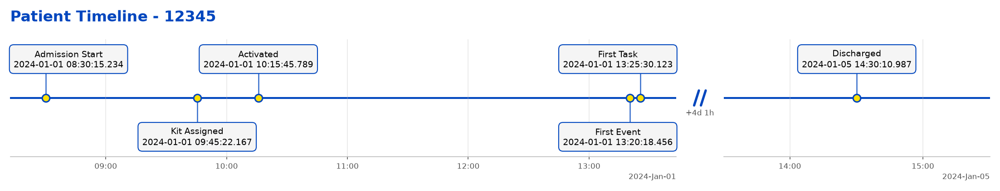
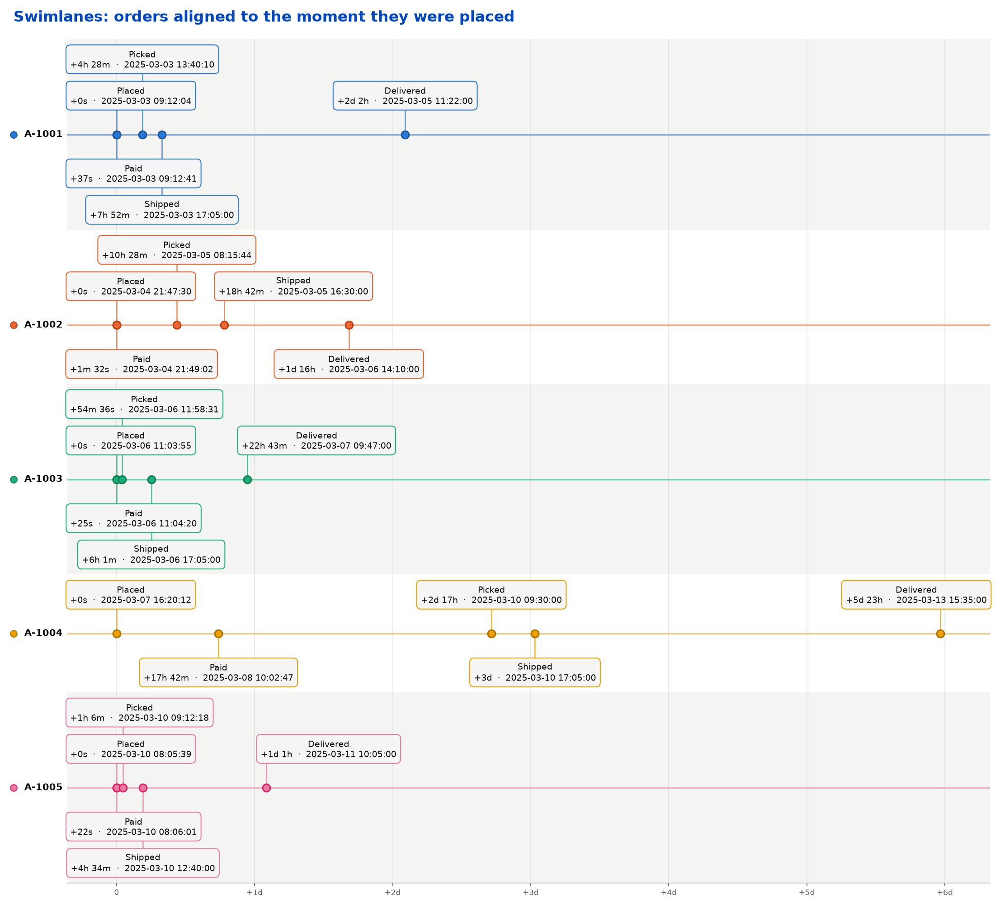
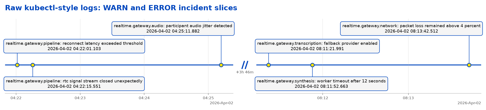
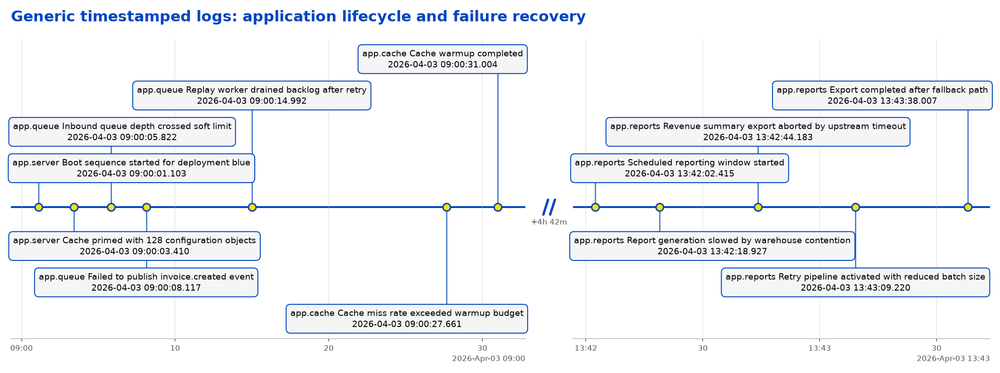
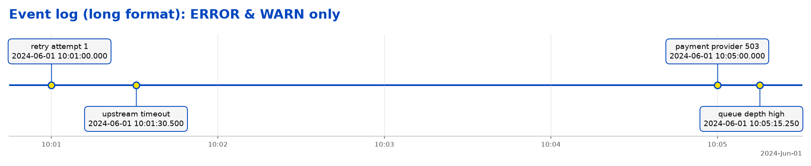
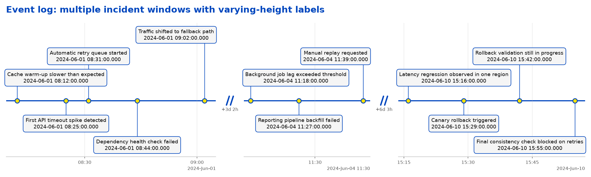
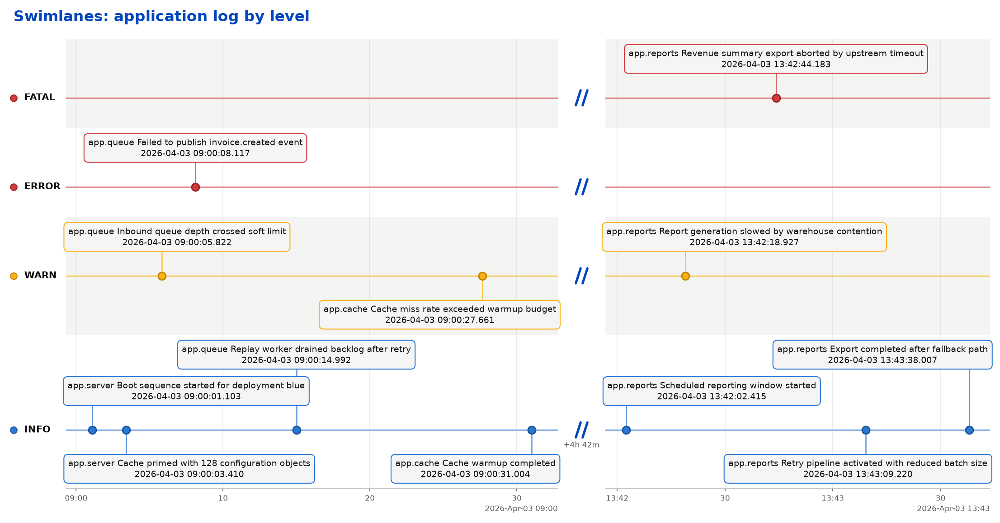
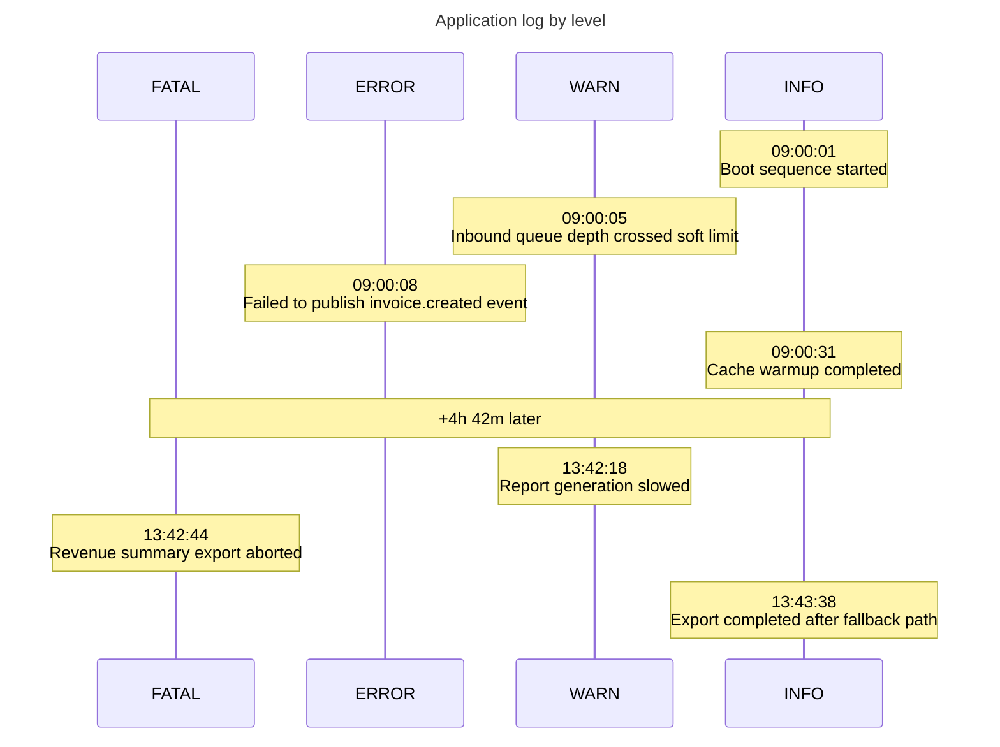
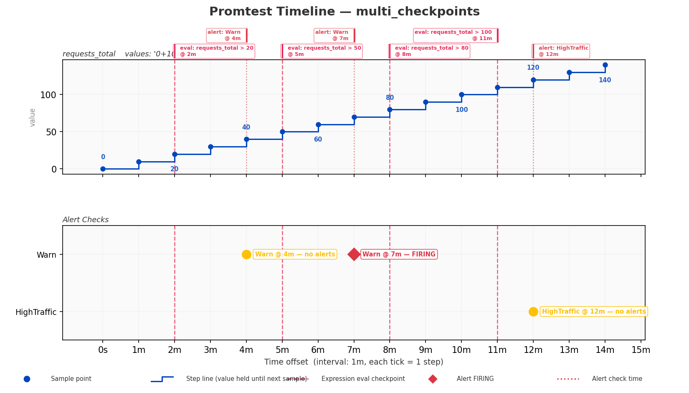
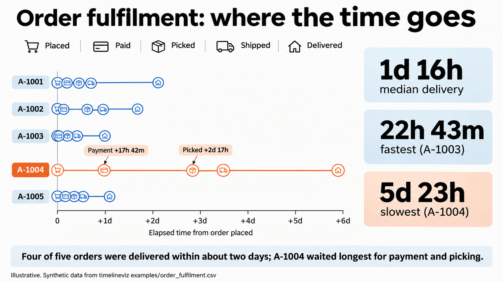

# timelineviz

[](https://pypi.org/project/timelineviz/)
[](https://pypi.org/project/timelineviz/)
[](https://github.com/garrywilliams/timeline_viz/actions/workflows/ci.yml)
[](https://github.com/garrywilliams/timeline_viz/blob/main/LICENSE)
[](https://deepwiki.com/garrywilliams/timeline_viz)

Timelines, swimlanes and Mermaid diagrams from CSVs, logs and Prometheus test files.

Point it at a CSV of milestones, an application log or a `promtool` test file and get a readable chart: labels that never collide, time gaps collapsed and labelled, and output as PNG, SVG, PDF, Mermaid text, or a plain-text facts block you can paste into a write-up or an image-model brief.

<!-- Image URLs use raw.githubusercontent.com so they render on PyPI; branch must match default (main). -->




## Features

- **Three inputs:** wide CSVs (one column per milestone), long-format event logs (one row per event, from CSV or raw text logs such as `kubectl logs`), and Prometheus `promtool` unit-test YAML.
- **Swimlanes:** one lane per log level, service or entity, on a shared clock or with every lane aligned to its own start.
- **Mermaid output** (`--format mmd`): sequence or gantt diagrams that render natively in GitHub, GitLab, Notion and Obsidian.
- **Facts** (`--format facts`): every event, duration and comparison as exact Markdown or JSON. Use it to brief a writer or an image model without numbers drifting.
- **Readable by construction:** label boxes never overlap and connectors never cross another label. The figure grows to fit.
- **Time breaks:** long gaps are collapsed and labelled with the time skipped (`+3d 2h`).
- **Date-aware axis**, colour-blind-safe lane palette, status colours for log levels, and customisable colour schemes.
- PNG, SVG or PDF output; reads files or stdin; CLI and Python API.

## Installation

```bash
pip install timelineviz

# or with uv
uv add timelineviz
```

Python 3.11 or newer is required.

For development:

```bash
git clone https://github.com/garrywilliams/timeline_viz.git
cd timeline_viz
make install
make precommit-install
```

Run `make` or `make help` for tests, linting, builds, and other tasks. CI, release, and maintainer setup details live in [DEVELOPING.md](https://github.com/garrywilliams/timeline_viz/blob/main/DEVELOPING.md).

## Upgrading from 0.x

1.0 keeps every 0.x function signature, but a few defaults and behaviours changed:

- `figsize` now defaults to `None`: 15in wide with the height fitted to the labels (was `(15, 5)`). Pass `(w, None)` to fix only the width. CLI `--figsize` takes `W` or `W,H`.
- `date_rotation` now defaults to `0` (was `45`).
- Timestamps with UTC offsets are converted to UTC instead of having the offset dropped, so events can move if your data mixes offsets.
- `color_scheme` / `--colors` accept a partial scheme and reject unknown keys or invalid colours with an error.

See the [CHANGELOG](https://github.com/garrywilliams/timeline_viz/blob/main/CHANGELOG.md) for everything else.

## Quick Start

### CSV / DataFrame Timelines

```bash
# Auto-detect timestamp columns
timelineviz data.csv --detect-timestamps --output-dir timelines

# Specify columns explicitly
timelineviz data.csv --timestamp-columns created_at updated_at completed_at

# Read CSV data from stdin
cat data.csv | timelineviz --timestamp-columns created_at updated_at completed_at

# Add more visually staggered label bubbles
timelineviz data.csv --timestamp-columns created_at updated_at completed_at --varying-height

# Vector output, fixed 12in width (height still fits the labels)
timelineviz data.csv -t created_at updated_at -o timelines --format svg --figsize 12
```

```python
from timelineviz import plot_timeline, plot_multiple_timelines

import pandas as pd

df = pd.read_csv("data.csv")

# Single entity
plot_timeline(
    df.iloc[0], timestamp_columns=["created_at", "updated_at", "completed_at"], entity_id="12345"
)

# Multiple entities
plot_multiple_timelines(
    "data.csv",
    timestamp_columns=["created_at", "updated_at"],
    id_column="entity_id",
    output_dir="timeline_images",
)
```

The plotting functions are wrappers over three building blocks you can also use directly: build a `Timeline` from your data, then render it.

```python
from timelineviz import Event, Timeline, render_timeline, timeline_from_wide

timeline = timeline_from_wide(df.iloc[0], ["created_at", "updated_at", "completed_at"])
# ...or assemble one by hand:
timeline = Timeline([Event(pd.Timestamp("2024-01-01 09:00"), "Kick-off")], title="Project")

render_timeline(timeline, output_file="timeline.svg", show_plot=False)
```

### Event log (long format)

Use this when each **row** is one event and times live in a **single column** (typical logs). Optionally keep or drop rows using another column (for example `level` or `event_type`) so you can focus on an incident and ignore noise.

```bash
timelineviz examples/incident_log.csv --event-log --log-time-column ts \
  --log-label-column message --log-filter-column level \
  --log-include ERROR WARN --output-dir timelines --no-show

# Pipe log rows straight in via stdin
tail -n 100 logs/development.csv | timelineviz --event-log --log-time-column ts \
  --log-label-column message --log-filter-column level \
  --log-include ERROR WARN --output-dir timelines --no-show
```

Omit the input path or pass `-` to read from stdin. This works for wide CSV mode, `--event-log`, `--swimlanes` and `--promtest`.

For plain-text logs, `timelineviz` can also parse common timestamp-first log lines directly in `--event-log` mode:

```bash
kubectl logs -n app-namespace deploy/my-service --tail=80 --timestamps \
  | timelineviz --event-log --raw-log-format auto \
    --log-include INFO WARN ERROR --output-dir timelines --no-show
```

This also works for many other timestamped logs, for example:

```bash
tail -n 100 app.log \
  | timelineviz --event-log --raw-log-format timestamped \
    --log-include INFO WARN ERROR --output-dir timelines --no-show
```

In raw log mode, `timelineviz` defaults to extracted columns `ts`, `level`, and `message`, so `--log-include` / `--log-exclude` work without any extra preprocessing. `kubectl` remains available as an explicit format alias.

Checked-in raw log fixtures:
- [`examples/raw_kubectl_logs.log`](https://github.com/garrywilliams/timeline_viz/blob/main/examples/raw_kubectl_logs.log)
- [`examples/raw_timestamped_app.log`](https://github.com/garrywilliams/timeline_viz/blob/main/examples/raw_timestamped_app.log)

Example outputs from those fixtures:





```python
from timelineviz import plot_event_log_timeline

plot_event_log_timeline(
    "incident.csv",
    timestamp_column="ts",
    label_column="message",
    filter_column="level",
    include_values=["ERROR", "WARN"],
    varying_height=True,
    output_file="incident_timeline.png",
    show_plot=False,
)
```

A small sample file is in [`examples/incident_log.csv`](https://github.com/garrywilliams/timeline_viz/blob/main/examples/incident_log.csv).

The diagram below is from that sample, using the CLI flags above (**`ERROR`** and **`WARN`** rows only, `message` as the label):



For a denser example with more incident points, varying-height label bubbles, and multiple time breaks, see
[`examples/review_event_log_breaks.csv`](https://github.com/garrywilliams/timeline_viz/blob/main/examples/review_event_log_breaks.csv)
rendered with `--varying-height --threshold-days 2`:



### Swimlanes

Put events in **lanes** to compare streams side by side: one lane per **log level** (or service, host, ...) on a shared clock, or one lane per **entity** with every lane aligned to its own first event.

```bash
# One lane per log level (raw logs use the parsed level column automatically)
timelineviz app.log --event-log --raw-log-format auto --swimlanes -o out

# Any column as the lane, e.g. service
timelineviz incident.csv --event-log --log-time-column ts --log-label-column message \
  --lane-column service -o out

# One lane per entity, aligned to each entity's first event (default for entities)
timelineviz examples/order_fulfilment.csv --id-column order_id --entity-name Order \
  --swimlanes -o out
```




Log levels are ordered by severity (FATAL → TRACE) and coloured by status. Other lanes keep their first-seen order and use a fixed colour-blind-safe palette; the lane name is always printed, so colour never carries meaning alone. `--align absolute|start` overrides the default axis. With `start`, there are no time breaks unless you pass `--threshold-days`.

```python
from timelineviz import render_swimlanes, timeline_from_event_log, timeline_from_wide_entities

logs = timeline_from_event_log("incident.csv", "ts", label_column="message", lane_column="level")
render_swimlanes(logs, output_file="levels.svg", show_plot=False)

orders = timeline_from_wide_entities("orders.csv", id_column="order_id")
render_swimlanes(orders, align="start", output_file="orders.png", show_plot=False)
```

### Mermaid output

`--format mmd` (or `to_mermaid()` in Python) writes [Mermaid](https://mermaid.js.org/) source instead of an image, so a timeline can live in a README, PR or incident write-up and render natively on GitHub, GitLab, Notion and Obsidian. Without `-o` it prints to stdout.

```bash
timelineviz app.log --event-log --raw-log-format auto --swimlanes --format mmd > timeline.mmd
timelineviz app.log --event-log --raw-log-format auto --swimlanes --format mmd --mermaid-style gantt
```

- `--mermaid-style sequence` (default): one participant per lane and a note per event, in time order. Long gaps get a "+4h 42m later" note.
- `--mermaid-style gantt`: one section per lane, with a milestone per event on a proportional time axis. Needs absolute alignment.

A shortened version of [`examples/swimlanes_levels.mmd`](https://github.com/garrywilliams/timeline_viz/blob/main/examples/swimlanes_levels.mmd):



### Facts and briefs

`--format facts` (or `to_facts()` in Python) states what the chart shows as exact text. For each lane it lists every event with date, weekday, time, time since the lane started and time since the previous event. Entity lanes then get a comparison: median, fastest, slowest, the longest single stage, and a table of every stage the lanes share. Log-level lanes or a single timeline get the largest quiet periods instead. Durations are rounded to two units (`1d 23h`). `--format facts-json` gives the same as JSON.

```bash
timelineviz examples/order_fulfilment.csv --id-column order_id --entity-name Order \
  --swimlanes --format facts
```

An extract from [`examples/order_fulfilment.facts.md`](https://github.com/garrywilliams/timeline_viz/blob/main/examples/order_fulfilment.facts.md):

```markdown
## A-1004

Elapsed 5d 23h, Fri 7 Mar 2025 16:20 to Thu 13 Mar 2025 15:35.

- Placed: Fri 7 Mar 2025 16:20 (start)
- Paid: Sat 8 Mar 2025 10:02, +17h 43m (17h 43m after Placed)
- Picked: Mon 10 Mar 2025 09:30, +2d 17h (1d 23h after Paid)
- Shipped: Mon 10 Mar 2025 17:05, +3d 1h (7h 35m after Picked)
- Delivered: Thu 13 Mar 2025 15:35, +5d 23h (2d 23h after Shipped)

## Comparison of 5 lanes

- Median elapsed: 1d 16h
- Fastest: A-1003, 22h 43m
- Slowest: A-1004, 5d 23h
- Longest single stage: A-1004, Shipped → Delivered, 2d 23h
```

```python
from timelineviz import fill_brief, timeline_facts, timeline_from_wide_entities, to_facts

orders = timeline_from_wide_entities("examples/order_fulfilment.csv", id_column="order_id")
print(to_facts(orders))  # Markdown
timeline_facts(orders)["comparison"]  # the same facts as a dict
```

### Prometheus Test Timelines

Visualise `promtool` unit-test YAML files — see series values change over time, where evaluations happen, and when alerts fire.

```bash
timelineviz examples/promtest_label_minimal.yml --promtest
timelineviz examples/promtest_label_minimal.yml --promtest --output-dir images --no-show
```

Replace the path with your own promtool unit-test YAML when needed. Checked-in examples live under [`examples/`](https://github.com/garrywilliams/timeline_viz/tree/main/examples).

```python
from timelineviz import parse_promtest_file, plot_promtest

groups = parse_promtest_file("examples/promtest_label_minimal.yml")
plot_promtest(groups, output_file="promtest_timeline.png")
```



Charts are self-documenting — each subplot shows the metric name and raw notation, value labels appear at transition points, eval/alert vertical lines are labelled, and a legend strip at the bottom explains all marker types.

> **Full guide:** [PROMTEST.md](https://github.com/garrywilliams/timeline_viz/blob/main/PROMTEST.md) — notation reference, worked examples, and all parameters.

## How It Works

### CSV Timelines

**Wide format** (default): each entity is a row; timestamps live in separate columns (for example `created_at`, `updated_at`). Those columns become labelled points on one timeline per entity.

**Long format** (`plot_event_log_timeline` / `--event-log`): many rows share one timestamp column; each row is one point. Filters apply before plotting.

Both formats are converted into the same `Timeline` model, then drawn in three stages:

1. **Model** (`timelineviz.model`): input rows become `Event`s (time plus label). Timestamps are normalised to UTC.
2. **Layout** (`timelineviz.layout`): events are split into panels wherever a gap exceeds `threshold_days`. Each label box is then placed in the lowest free track above or below the line, either centred on its event or shifted left/right. A box never overlaps another box, and a connector never passes through another label. The figure height follows from the tallest stack.
3. **Render** (`timelineviz.render_mpl`): matplotlib draws the panels, a date-aware time axis, and slash marks at each break labelled with the time skipped (e.g. `+3d 2h`). The output format follows the file extension.

### Promtest Timelines

Prometheus test files define metric series as values over discrete time steps (e.g. one value per minute). The library:

1. Parses the YAML and **expands the compact notation** (`1+2x5` → `1, 3, 5, 7, 9, 11`)
2. Plots each `input_series` as a **step chart** on its own subplot
3. Draws **vertical markers** at `eval_time` checkpoints
4. Shows **alert check points** with firing/pending status
5. Labels the x-axis with **relative time offsets** (`0s`, `1m`, `2m`, …)

Optional **`break_gap_minutes`** / CLI **`--promtest-break-gap`**: when gaps between anchors (`0`, series end, each eval/alert time) exceed that many minutes, the chart splits into **multiple horizontal panels** with slash markers—same idea as CSV **`threshold_days`** breaks. See [PROMTEST.md](https://github.com/garrywilliams/timeline_viz/blob/main/PROMTEST.md) and [`examples/promtest_time_breaks.yml`](https://github.com/garrywilliams/timeline_viz/blob/main/examples/promtest_time_breaks.yml).

## From chart output to executive summaries

`timelineviz` draws faithful, technical timelines. For a stakeholder deck you can turn one into an infographic with a multimodal image model. The workflow:

1. **Plot** the timeline. That chart stays the record.
2. **Generate the facts** with `--format facts`. Image models copy written numbers faithfully but drift when they copy positions from a chart.
3. **Fill a brief** with `--brief-template FILE`, which replaces `{{facts}}` and `{{title}}` in your template. [`docs/brief-template.md`](https://github.com/garrywilliams/timeline_viz/blob/main/docs/brief-template.md) is a starting point: it forbids invented facts and asks for a design without a time axis.
4. **Attach the chart only as context**, or leave it out, so the model doesn't copy its geometry.
5. **Check** every number in the image against the facts, and label it illustrative.

```bash
timelineviz examples/order_fulfilment.csv --id-column order_id --entity-name Order \
  --swimlanes --format facts --brief-template docs/brief-template.md > brief.md
```

[`docs/infographic-prompt.md`](https://github.com/garrywilliams/timeline_viz/blob/main/docs/infographic-prompt.md) is a hand-written brief built from the same facts, using a week-planner concept.



*Illustrative, image-model output; markers not to scale. It was made from an earlier brief that included a time axis. The milestone markers drift from their true times (A-1004's payment was at +17h 43m, not near +1d), and the bottom sentence leaves out A-1004's longest wait, the 2d 23h delivery leg. The exact chart is [`images/swimlanes_orders.png`](https://raw.githubusercontent.com/garrywilliams/timeline_viz/main/images/swimlanes_orders.png) and the exact numbers are in [`examples/order_fulfilment.facts.md`](https://github.com/garrywilliams/timeline_viz/blob/main/examples/order_fulfilment.facts.md).*

## API Reference

### CSV Mode

| Parameter | Description |
|-----------|-------------|
| `timestamp_columns` | Columns containing timestamp data to visualise |
| `id_column` | Column that uniquely identifies each entity |
| `threshold_days` | Time gap (in days) that triggers a timeline break |
| `varying_height` | Stagger labels over several heights even where they would fit lower (labels never overlap either way) |
| `figsize` | `None` (default): 15in wide, height fits the labels. `(w, None)`: fixed width. `(w, h)`: fixed size |
| `entity_name` | Type name for titles (e.g. "Patient", "Order") |
| `label_mappings` | Custom display names for timestamp columns |
| `color_scheme` | Colour overrides; any subset of `line`, `point_edge`, `point_face`, `connector`, `label_bg`, `label_edge`, `slashes`, `title` |
| `output_file` / `output_format` | Save path (extension picks PNG/SVG/PDF) / format for `plot_multiple_timelines` and CLI `--format` |

### Swimlanes, Mermaid and facts

| Parameter | Description |
|-----------|-------------|
| `lane_column` | `timeline_from_event_log`: column whose value names each event's lane (CLI `--lane-column`; raw logs default to `level`) |
| `id_column` | `timeline_from_wide_entities`: one lane per value (or per row when omitted) |
| `align` | `"absolute"`: shared clock. `"start"`: each lane starts at 0 and the axis shows elapsed time. CLI `--align auto` picks `start` for entities |
| `lane_order` / `lane_colors` | Lane order top to bottom / per-lane colour overrides. Defaults: severity order for log levels, otherwise first seen |
| `format` | `to_facts`: `"markdown"` (default) or `"json"` (CLI `--format facts` / `facts-json`) |
| `compare_lanes` | `timeline_facts` / `to_facts`: include the lane comparison. Default: on for two or more lanes that are not log levels |
| `style` | `to_mermaid`: `"sequence"` (default) or `"gantt"` (CLI `--mermaid-style`) |
| `threshold_days` | Swimlanes: gap that triggers a shared break. Mermaid sequence: gap that adds a "+gap later" note |

### Promtest Mode

| Parameter | Description |
|-----------|-------------|
| `figsize` | Figure dimensions `(width, height)` in inches |
| `title` | Custom figure title |
| `color_scheme` | Override colours (see [PROMTEST.md](https://github.com/garrywilliams/timeline_viz/blob/main/PROMTEST.md#colour-scheme)) |
| `output_file` | Save to PNG |
| `dpi` | Resolution (default 150) |

## License

[MIT](https://github.com/garrywilliams/timeline_viz/blob/main/LICENSE)
